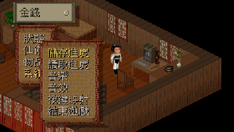
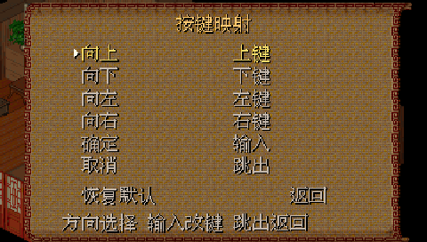
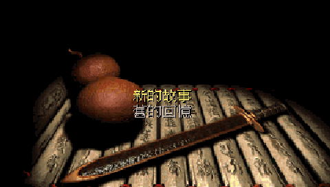
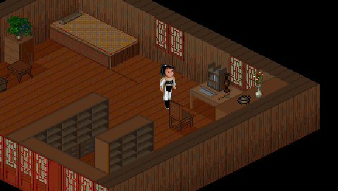

# 仙剑1 for BBK H1 / Y100

基于 SDLPAL 的原生 H1 BDA，参考 HelloClyde 的 BBK9588-pal1 移植。
适用于 H1 / Y100 V1.41，固定全屏显示，应用名称为“仙剑1”。v0.1.9 将按键映射直接放入“系统”菜单，保留原版画风；继续支持 H.264 压缩过场：视频包由 188.8 MB 降到 43.8 MB，保留 288×180、15 fps 与原音轨。

## 快速开始

从本项目 [Releases](https://github.com/HelloClyde/BBKH1-pal1/releases) 下载 `PAL1.bda` 或程序安装 ZIP。
单独下载的 BDA 复制到设备时命名为“仙剑1.bda”；安装 ZIP 内已使用这个中文名称。
程序 ZIP 只包含程序与说明；`PAL9588.PAK` 和 `PALVIDEO.PAK` 作为独立 Release 附件提供，
也可从自己拥有的原版安装目录生成。两个 PAK 下载后按下列路径放置。
v0.1.9 只更新 BDA；首次安装可从 [v0.1.7](https://github.com/HelloClyde/BBKH1-pal1/releases/tag/v0.1.7) 下载两个资源包。
升级压缩视频时，同时替换 BDA 和 `PALVIDEO.PAK`；`PAL9588.PAK`、配置与存档继续使用。
新版 BDA 也兼容旧 MS Video 1 视频包；新 H.264 包需要 v0.1.7 或更新程序。

```text
A:\应用\程序\仙剑1.bda
A:\应用\数据\PAL\PAL9588.PAK
A:\应用\数据\PAL\PALVIDEO.PAK    （可选）
```

资源也可放在 `B:\应用\数据\PAL\`。启动先检查 A 盘的 `PAL9588.PAK`，
A 盘没有该主资源包时才检查 B 盘。两盘都有时始终选 A；A 盘只有目录或视频包不会阻止回退到 B。
主资源和视频包使用同一盘，存档、配置和日志默认也写到所选盘的同一目录。
不自动迁移旧存档；把资源移到 B 盘时，请一并复制需要保留的 `1.rpg`～`5.rpg` 和 `sdlpal.cfg`。
A 盘主资源包存在但损坏时会提示错误，不会自动改用另一盘的存档。

将程序与资源放到上述路径，重新进入 H1 桌面后点击“仙剑1”。
缺少视频包时使用 DOS RNG 动画；主资源包必需。
使用 `build/resources/` 中自己准备的资源进行测试与本地打包。

### 从 Steam 安装目录准备资源

需要 Python 和 PATH 中的 FFmpeg。传入自己的 PAL 安装目录：

```powershell
python tools/prepare-steam.py --steam-root "D:/SteamLibrary/steamapps/common/PAL" --output build/resources
```

工具读取 `PAL_DOS` 的 21 项核心数据和 `PAL98` 的六段 AVI，生成两个 PAK。
默认将六段视频编码为适合 H1 的 H.264 Constrained Baseline，使用原始分辨率、帧率和逐样本不变的 PCM 音轨。
选择 CRF 18、单参考帧、无 B 帧/CABAC/去块滤波与全像素运动搜索，减少 MIPS 解码开销。
AVI 作为容器不变；压缩的是视频编码。需要保留原始画面数据时，加 `--video-codec original`。
也可通过 `tools/palpak.py pack <数据目录> <输出PAK>` 打包，或复用兼容的旧 PAK。
资源格式与详细来源见 [NOTICE.md](NOTICE.md)。源码仓库不包含游戏数据包、存档或固件；
Release 中的独立 PAK 附件保留原游戏资源权利，不属于源码的 GPL 许可。

存档为同目录 `1.rpg`～`5.rpg`，游戏配置为 `sdlpal.cfg`，按键配置为 `h1keys.cfg`，日志为 `H1PAL.LOG`。

## 截图

以下为本项目实际运行截图；均来自模拟器，没有物理真机截图。

| v0.1.9：系统菜单 | v0.1.9：按键映射 |
| --- | --- |
|  |  |

| H1 完整固件：桌面图标 | H1 完整固件：启动菜单 |
| --- | --- |
|  |  |

| H1 完整固件：地图 | H1 完整固件：仙术 |
| --- | --- |
|  |  |


系统菜单与按键映射来自 v0.1.9，主菜单和地图来自 v0.1.7；其余截图对应此前的已记录构建，具体哈希与范围见验证文档。

## 操作

以下为默认按键。游戏中直接进入“系统 → 按键映射”，
可修改上、下、左、右、确定和取消六个动作；选中动作，按输入，再按新键即可保存。
重复绑定会交换原有按键，防止两个动作冲突。跳出可取消正在进行的改键，支持“恢复默认”。
设置页始终用 H1 原来的方向、输入和跳出操作；长按物理输入+跳出的退出组合也保持有效。
映射保存到所选 A/B 资源盘的 `h1keys.cfg`，下次启动自动读取；配置缺失或损坏时回到默认。
文件写入失败会提示重试，当前映射保持不变。

| 按键 | 功能 |
| --- | --- |
| 方向键 | 移动、菜单选择 |
| 输入 / 确定 | 调查、确认、推进对话 |
| 跳出 / 取消 | 打开菜单、取消、返回 |
| 同时长按 Enter + Esc | 退出应用并返回 H1 桌面 |
| 点击地图目标 | 绕开障碍自动行走；点击可调查对象可走近调查 |

实体方向或确认/取消会中断自动行走。剧情、对话、菜单和战斗期间不启动触摸寻路；
滑动和画面黑边不会当成地图点击。游戏中通过“系统 → 储存进度 / 读取进度”存读档。

## 实现

- 完整地图、脚本、对话、道具、战斗和原生存档核心。
- 地图视口扩为 **360×204**，横纵都按 **4/3** 倍显示到 **480×272**；
  相对原视野左右各多显示 20 个地图像素、上下各多 2 个。人物、地砖和地图上的菜单保持相同比例。
  新区域包含 NPC 与遮挡层，也支持触摸寻路；游戏逻辑坐标、剧情触发、碰撞和存档格式不变。
- 战斗背景单独等比放大到 360×225，再从上下居中裁取 360×204；
  原图上下各约 9 行不显示，左右完整保留。背景在 LCD 上等比放大 1.5 倍，
  人物、敌人、文字和技能保持与地图相同的 4/3 比例，无横向拉伸。
  战斗切换/淡入、调色板闪光、水波、震屏与跨出旧画幅的 RLE 效果使用完整宽度。
  直接沿用原始 FBP 图片，不需要重新打包游戏资源。
- 启动、存读档、状态、装备、仙术、物品、商店和确认菜单均使用完整 480×272 画布。
  启动背景等比铺满；状态和装备背景补齐边缘纹理，保留原有头像、装备格和标签尺寸。
  仙术/物品的选择光标移到文字左侧，不再覆盖字形；装备列表名称对齐背景标签，状态页名称按图标格居中。
  字体、头像和图标横纵都按 4/3 显示，没有单独拉宽。
- AVI 视频保留原画幅等比显示。
  游戏固定全屏，不设缩放快捷键；默认 Z、X、V 和空格不触发操作，可在按键映射中主动绑定。
- 按键映射使用原 UI 边框精灵、像素字体和调色板，保持 480×272 下的等比显示。
- 480×272、32 位 H1 游戏帧缓冲；调色板游戏和 RGB555 AVI 均保持横屏方向。
- RIX/DBOPL 音乐、VOC/WAV 音效；22050 Hz 单声道混音经整数重采样输出至
  H1 的 32000 Hz PCM 环形缓冲；退出时停止 PCM 并恢复原音量。
- H264BSD 播放 H.264 Baseline AVI，SDLPAL 解码器继续兼容 MS Video 1；不链接商业 H1 飞天影音的二进制代码。
- H1 文件、内存、游戏窗口、校准触摸和同时按键接口；没有链接 9588 SDK。
- 独立 512 KiB 栈，退出统一关闭容器句柄并回收本应用分配的内存。

## 依赖

| 用途 | 依赖与固定版本 |
| --- | --- |
| 运行 | BBK H1 / Y100 V1.41；使用者自己的仙剑 DOS 核心资源，PAL98 视频可选 |
| 引擎子模块 | [SDLPAL](https://github.com/sdlpal/sdlpal)，`224cb0a0cc839e0e8ecaa299cd480b02b372b9f7` |
| SDK 子模块 | [H1 BDA SDK](https://github.com/MrDefinition1999/bbk-h1-bda-sdk)，`067fe072477861dfc8949d7b1a55279fb92d2548`，目录 `sdk/` |
| H.264 子模块 | [H264BSD](https://github.com/oneam/h264bsd)，`42bcb5d753ad86d84903354bf3c68423c28adb7b`，目录 `third_party/h264bsd/` |
| 已验证开发环境 | Windows x64，Python 3.11.5；GNU MIPS little-endian soft-float GCC 15.2.0；Actions 配置为 Python 3.12 |
| Python | Pillow 12.3.0（图标打包），Unicorn 2.1.4、pyelftools 0.33（主机 MIPS 服务模型测试） |
| 可选资源生成 | FFmpeg（需放入 PATH）；原版游戏安装文件 |

依赖固定信息见 [UPSTREAM.json](UPSTREAM.json)，工具链压缩包 URL 与 SHA-256 见 `tools/install_toolchain.py`。
正常编译无需下载游戏资源，也无需系统字体；图标 PNG 已保存于 `assets/`。
核心子模块的 SDL、GoogleTest 等嵌套依赖不参与此原生移植，不必递归初始化。

## 开发构建

在 Windows PowerShell 中执行；每步失败应停止：

```powershell
git clone https://github.com/HelloClyde/BBKH1-pal1.git
cd BBKH1-pal1
git submodule update --init sdk third_party/sdlpal third_party/h264bsd
python -m pip install -r requirements.txt
python tools/install_toolchain.py
python tools/build.py
python tools/verify_release.py
```

输出为 `dist/仙剑1.bda`，`H1PAL.bda` 为内容相同的兼容副本。
已有工具链可使用 `python tools/build.py --toolchain C:/tools/mipsel-none-elf/bin`，或设置 `H1_GNU_BIN`。
构建器校验子模块提交及干净状态；固定 `SOURCE_DATE_EPOCH=1792368000`，避免 SDLPAL 的编译日期破坏可复现性。
入口固定 `0x83C00020`，镜像、BSS 和独立 512 KiB 栈不超过 H1 的 4 MiB 加载窗口。
`tools/core_overrides.py` 从未修改的核心生成带上下文校验的 H1 场景、战斗及菜单适配副本。

资源无关测试（Actions 中也执行）：

```powershell
python -m unittest discover -s tests -p "test_*.py"
python tests/wide_ui.py
python tests/wide_battle.py
python tests/display_controls.py
python tests/keymap.py
python tests/music.py
python tests/h264_video.py
python tests/mips_smoke.py --missing
python tests/data_drives.py
```

本地真实游戏资源测试使用 `build/resources/PAL9588.PAK`；菜单与地图测试还需要使用者自己的
`build/verification/native-1.rpg`。可用 `python tools/build.py --regression` 构建独立测试 BDA；
正式 BDA 不执行测试标记。视频抽样测试默认使用 `build/h264-resources/`，也可用 `--resources` 指定自有资源目录。上述数据不随仓库分发。

提交源码后执行 `python tools/package_release.py` 可生成程序安装 ZIP、含三项固定依赖的完整源码 ZIP、
BDA、构建信息、验证清单及 SHA256SUMS；此公开打包入口不读取游戏资源。
`tools/package.py --resources build/resources` 只用于个人本地生成含自有资源的完整安装包，请勿作为公共 Release 上传。
源码 ZIP 已展开构建必需子模块，可跳过子模块初始化直接执行安装依赖、安装工具链和构建命令；
构建器按 `SOURCE-MANIFEST.json` 校验依赖文件哈希。开发与更新请优先使用 Git 克隆。

## 验证范围

当前 BDA SHA-256：`8bf2d9a7df8c637243e864c733d1a1591c103661fc2da8040f88f50bc41230e2`。
2026-10-21 的 v0.1.9 将按键映射移至系统菜单，保留改键、交换、固定设置页操作和原有配置。
主机模型实际执行编译后的 MIPS 代码，检查 UI、战斗背景、触摸、A/B 资源选择和缺资源退出；
完整 H1 固件模拟器另行检查读档、地图、系统菜单直达按键映射、改键和独立的是否退出确认。
此前程序重启读取和恢复默认记录保留在 [v0.1.8 验证](docs/verification-v0.1.8.md)。
H.264 完整片头、原音轨 PCM 与时间线记录保留在 [v0.1.7 验证](docs/verification-v0.1.7.md)。
旧版 A/B 存档重启读回记录保留在 [v0.1.5 验证](docs/verification-v0.1.5.md)。
此前地图、战斗、存档、视频与 13 类菜单的检查及不同构建哈希均保留在
[当前验证](docs/verification.md) 和 [菜单验证](docs/verification-v0.1.4.md)。

Actions 在 main、PR 和手动运行时编译、校验并保存临时产物；`v*` 标签触发预发布，
Release 使用同一构建产物。CI 不执行私有固件，也不宣称物理真机测试通过。
**尚未进行物理 H1 测试或全剧情通关。**

## 许可与感谢

本移植源码按 GPL-3.0-or-later 提供，第三方文件保留原许可；详见 [LICENSE](LICENSE)、[NOTICE.md](NOTICE.md)。
游戏素材、名称和商标的权利归原权利人，文档截图不改变这些权利。

感谢 [HelloClyde/BBK9588-pal1](https://github.com/HelloClyde/BBK9588-pal1) 提供 9588 参考移植与兼容层、PAK、AVI 和寻路实现；
感谢 SDLPAL 及 AdPlug/OPL、FFmpeg 相关贡献者；感谢 MrDefinition1999 的 H1 BDA SDK。
感谢 Android Open Source Project 与 Sam Leitch 的 H264BSD；H1 飞天影音提供了本机 H.264/MPEG-4 能力的参考。
图标通过内置 GPT Image 重新设计，保留原红色“仙”字主体，参考 H1 桌面图标；提示词、参考图和来源记录在 `assets/`。
