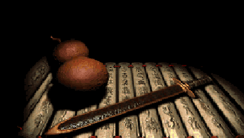
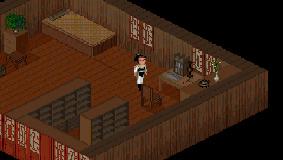

# 主干改动（v0.1.9 之后，尚未发布）

- 加入融合的 Sharp Bilinear：等价于最近邻放大 2 倍后再双线性取样，使用像素中心坐标与 Q8 整数计算，无需生成两倍中间图。
- 地图、人物及文字保持 4/3 等比，输出仍为 480×272。战斗和标题背景保留原始 320×200 图，直接按 1.5 倍等比覆盖到屏幕，不再从已经放大的背景二次取样。
- 保留原来的逻辑画布供脚本、遮挡和效果使用；字体、精灵与菜单区域有独立的覆盖记录。背景缓存按调色板和颜色偏移失效，菜单局部保存、恢复与全屏备份均携带这些记录。
- 水波、震屏与尚未完成的逐像素转场保留兼容的逻辑效果路径，仍使用 Sharp Bilinear 输出。
- 主资源中的音乐及说明逐字节读取增加每流 4 KiB 缓冲，修复从 SD 启动时长时间黑屏。音乐初始化底层读取由 331383 次降至 174 次（MIPS 服务模型计数）。
- A/B 优先级、B 盘资源、存档与配置格式不变。此次只更新程序。

此主干构建仍保留 0.1.9 版本标识，和既有 Release 的 BDA 字节不同；以提交与 SHA-256 区分。
新 BDA SHA-256：`8b44f8b3219f93c708f00511377d41750e0f918df6e9454e2402835a4f857a30`。
没有新标签或 Release，也未覆盖原有公开附件。

模型检查包括缩放参考像素、背景单次取样、遮挡、嵌套菜单恢复、调色板缓存、32 位颜色通道、文件缓存边界及内存回收；
另以自有资源检查 13 类菜单、一场自动战斗、物品介绍和按键设置。
相同正式 BDA 已通过 H1Debug 更新到物理 H1，设备读回 CRC 正确，启动和过场画面正常；使用者实测后确认耗时可接受。
没有采集到真机地图的定量耗时，亦未对这个 SHA 重新执行完整固件模拟器或全剧情验证。
记录见 [当前构建](evidence/current-build.json)。

Sharp Bilinear 的原理参考 [rsn8887 的说明](https://github.com/rsn8887/Sharp-Bilinear-Shaders)，
这里使用独立编写的 CPU 定点实现。对比图为本项目实际 MIPS 渲染输出：

| 旧版最近邻 | 主干 Sharp Bilinear |
| --- | --- |
|  |  |
|  |  |
